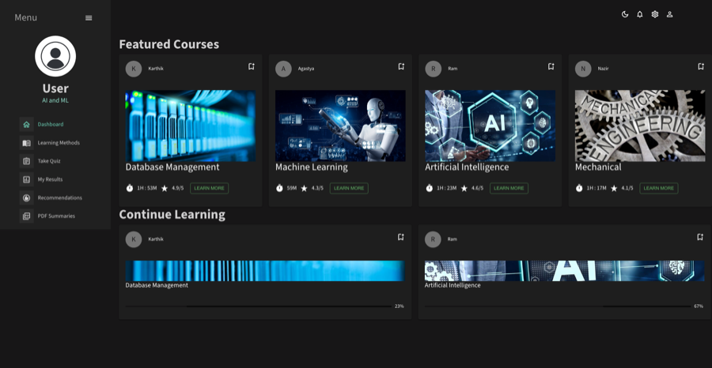
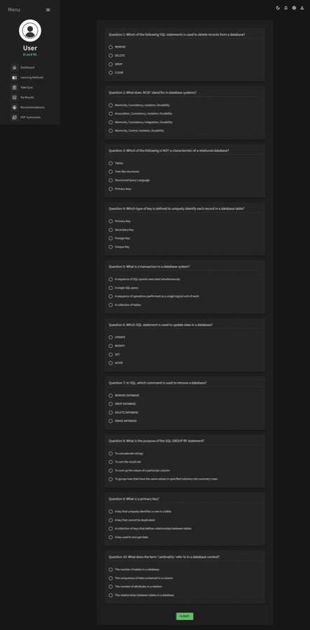
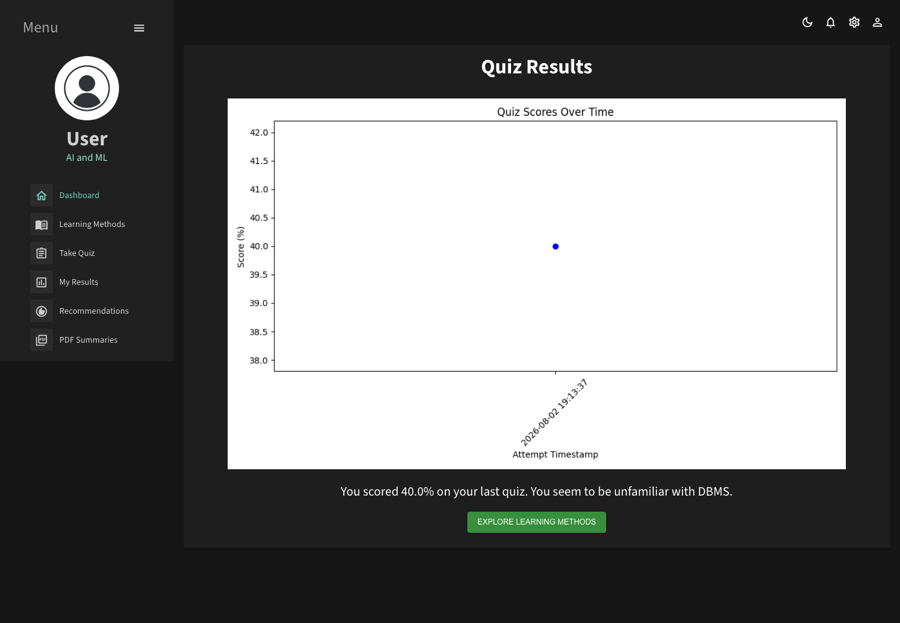

# Intelligent Tutoring System

[](https://github.com/vxkram/intelligent-tutoring-system/actions/workflows/tests.yml)

A DBMS study app: take a quiz, get a plain-language readout of how you did, and get resource recommendations that actually change based on your score — plus text/video learning hubs and PDF summarization.

| Dashboard | Quiz | Results |
|---|---|---|
|  |  |  |

**Stack:** FastAPI backend · React + Material-UI frontend · Node/Express + MongoDB (auth)

## What actually works

- **Quiz → score → tiered recommendations.** `/quiz` samples 10 questions from a 25-question DBMS bank, scores your submission, and `/content_rec` recommends Beginner/Intermediate/Advanced resources based on that score — this loop is real and tested (see `backend/test_backend.py`).
- **Results page** with a real matplotlib chart of your score history over time.
- **PDF summarization** (`/pdf_sum`): extracts text from a PDF (PyMuPDF), summarizes it (NLTK frequency scoring), and returns a downloadable one-page summary PDF.
- **Learning-method hub** (`/ELM`) linking to the PDF summarizer and the recommendation page.

## What's honest-but-limited

- **Login is a placeholder.** It doesn't check credentials against anything — submitting takes you straight to the dashboard. **Register** does write to MongoDB via the Node auth server, but nothing reads it back at login time. There's no session/token anywhere in the app.
- **`/quiz_2`** is a second, minimal quiz variant (currently one question) wired end-to-end but not linked from navigation — reachable by URL only.
- Passwords are stored in plaintext in MongoDB. Fine for a local demo, not for anything real.

## Project structure

```
backend/    FastAPI app (main.py) + quiz/scoring/recommendation/PDF-summary modules
server/     Node/Express + MongoDB registration endpoint (port 3001)
src/        React frontend (port 3000)
```

## Setup

You need three processes running: the FastAPI backend, the frontend, and (only if you want Register to work) the Node auth server + a local MongoDB.

### Backend

```bash
cd backend
python3 -m venv .venv
source .venv/bin/activate
pip install -r requirements.txt
python main.py   # serves on :8000
```

### Frontend

```bash
npm install
npm start   # serves on :3000
```

### Auth server (optional — only needed for Register)

```bash
cd server
npm install
# requires a local MongoDB running on the default port (mongodb://localhost:27017)
npm start   # serves on :3001
```

## Running tests

```bash
# backend — 14 tests, no model/network dependencies
cd backend && pip install -r requirements.txt && pytest

# frontend — 2 tests
npm test -- --watchAll=false
```

## Notes

None of this was actually runnable before this pass: the frontend couldn't even `npm install` (a peer-dependency conflict) or build (hardcoded Windows paths in two components rendered on the first page after login), and the backend failed to boot for the same reason (`/static` mounted from a hardcoded path). See the git history for the specific fixes, including a scoring bug that had permanently capped every quiz at 40% and silently broken the recommendation feature this app is actually about.
